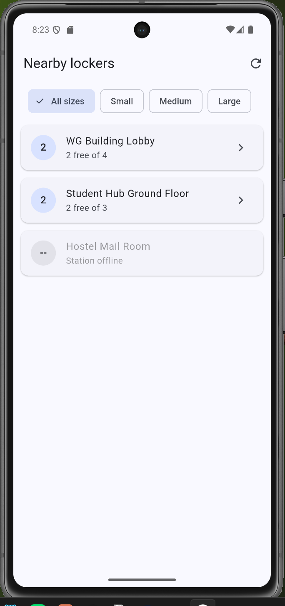
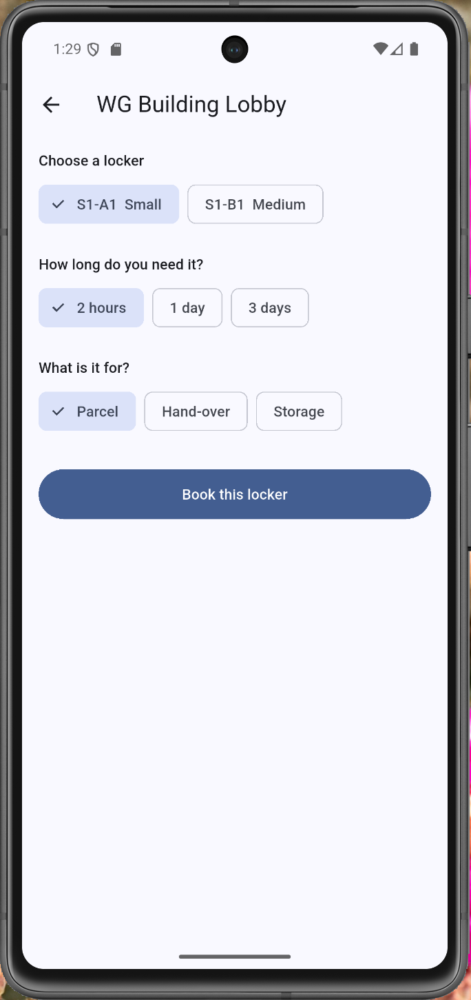
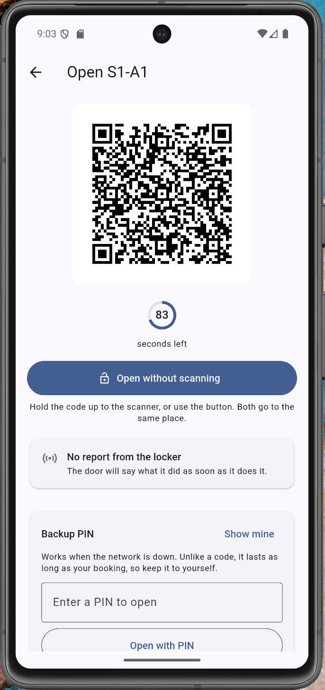
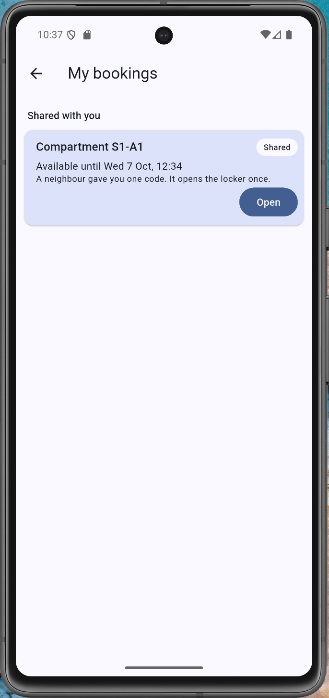
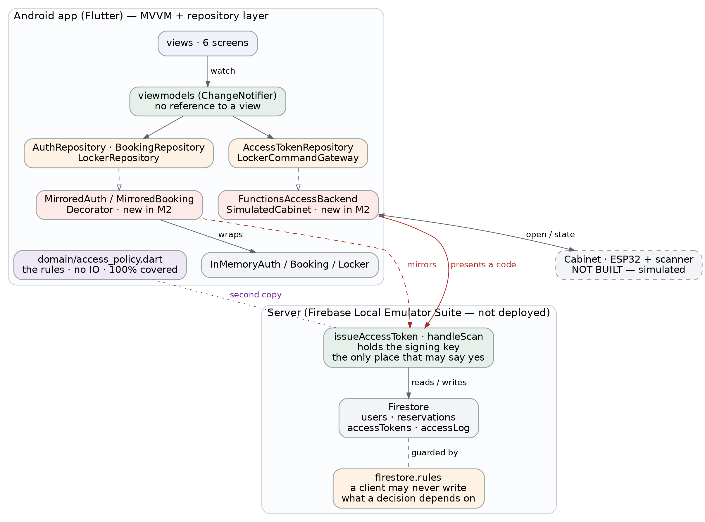

# Smart Community Locker System (SCLS)

[](https://github.com/antonyzhu2023-cloud/smart-community-locker/actions/workflows/ci.yml)
[](#running-the-tests)
[](#running-the-tests)
[](#compiling-and-running-the-project)

A mobile app for booking and opening **shared lockers in a community**, such as an
apartment building or a university campus. Unlike carrier-operated parcel lockers, SCLS is
not owned by one courier, lets a resident **book a compartment in advance**, and lets them
**pass one-time access to a neighbour** so an item can be handed over without the two people
meeting.

Built for COMP826 Mobile Systems Development, Auckland University of Technology.

> **Status:** Milestone 2 prototype. Five of the nine requirements are built. The rest are
> declared in [Feature status](#feature-status) rather than left half-finished.

---

## Contents

- [Screenshots](#screenshots)
- [Compiling and running the project](#compiling-and-running-the-project)
- [Running the tests](#running-the-tests)
- [How it works](#how-it-works)
- [Architecture](#architecture)
- [Running it against the real server](#running-it-against-the-real-server)
- [Feature status](#feature-status)
- [Repository layout](#repository-layout)
- [Known limitations](#known-limitations)

---

## Screenshots

<table>
<tr>
<th width="25%">Find a locker</th>
<th width="25%">Book it</th>
<th width="25%">Open it</th>
<th width="25%">Hand it to a neighbour</th>
</tr>
<tr>
<td></td>
<td></td>
<td></td>
<td></td>
</tr>
<tr>
<td>Three seeded stations. An offline station shows no count.</td>
<td>One screen. A receipt replaces the form so it cannot be submitted twice.</td>
<td>A signed code, 120 seconds, works once.</td>
<td>The neighbour's own account. One button, no cancel, no extend.</td>
</tr>
</table>

More screens, including the waiting and door-open states and the offline PIN,
are in [`docs/screenshots/`](docs/screenshots).

---

## Compiling and running the project

The prototype runs on its own. It needs no Firebase project, no API key and no MQTT broker.
All state is held in memory and three stations are seeded at startup.

### What you need

- Flutter 3.x with the Dart SDK. <https://docs.flutter.dev/get-started/install>
- Android Studio, for the Android SDK and an emulator. Coding can be done in VS Code.
- An emulator or device on API 29 or above. The minimum SDK is 29 because Milestone 1
  justified Android 10 on market reach.

### Run it

```bash
git clone https://github.com/antonyzhu2023-cloud/smart-community-locker.git
cd smart-community-locker/app
flutter pub get
flutter run
```

### Test credentials

The app starts with no accounts. Register with any email address and a password of at least
six characters.

Four membership codes are seeded. Each one can be claimed once.

```
WG-1041    WG-1042    SH-0207    HM-0115
```

A correct code verifies the account straight away. Registering without one still creates
the account, but that account cannot reach the locker list. That is requirement E1 and it
is worth trying.

To see the hand-over feature, register two accounts, book a compartment on the first, then
hand it to the second account's email address.

**No credentials are in this repository.** `firebase_options.dart` and
`google-services.json` are both gitignored.

---

## Running the tests

```bash
cd app
flutter analyze
flutter test --coverage
```

```bash
cd functions
npm install
npm test
```

425 cases in total: 378 in Dart, 47 in Jest.

CI runs both suites on every push, plus `dart format --set-exit-if-changed` and
`flutter analyze`. The coverage gate measures **the whole of `lib/`** and fails the build
below 70%. It used to name two directories and skip `lib/views/`, which went stale as soon
as the views grew real logic. See [`.github/workflows/ci.yml`](.github/workflows/ci.yml).

Current line coverage is 91.46% across `lib/`, and 92.17% across the viewmodel and
repository layers that QR6 names.

---

## How it works

```
Flutter app  ──HTTPS/TLS──▶  Firebase Cloud Functions  ──▶  Cloud Firestore
     ▲                                  │
     │ FCM push                         │ MQTT publish (QoS 1)
     │                                  ▼
     └──────────────────────  MQTT broker  ──▶  Locker controller
                                                (ESP32, or the Python simulator)
```

The app never decides whether an access code is valid. It asks the server for a signed,
single-use code with a 120-second lifetime, shows it as a QR code, and the **server**
validates the scanned payload before publishing an open command to the locker. The locker
reports the real door-sensor state back, and only then does the app tell the user the
compartment is open.

Architecture: **MVVM with a repository layer**. See [`docs/diagrams/`](docs/diagrams) for
the UML.

**What the prototype actually runs.** The screens, the viewmodels and the access rules are
real. The data sources behind them are in-memory implementations of the same interfaces,
built and injected in [`app/lib/main.dart`](app/lib/main.dart). Swapping them for Firebase
is a change to that one file, which is the claim Milestone 1 made for the repository layer.
The Cloud Functions are real TypeScript with their own test suite, and the access rules
exist in both languages so that the server copy is the authority.

---

## Architecture



MVVM with a repository layer. Screens hold no logic, and every data source sits behind an
interface, so nothing above knows whether a booking comes from a database or from memory.
That seam is why the whole opening path has tests without a broker or a cabinet existing,
and why the Cloud Functions could be connected late without touching a screen.

Pink is new in Milestone 2. `MirroredAuthRepository` and `MirroredBookingRepository` are
decorators: they forward to the in-memory implementations and then copy the result where
the functions can read it, so the wrapped classes and their tests were left untouched.

---

## Running it against the real server

The steps above run the app on in-memory stand-ins, which is the default and needs nothing
else running. The app can also talk to the two Cloud Functions, which is where the access
decision for FR4 and FR5 actually belongs.

**No Firebase account is needed.** The project id is `demo-scls`, and the emulators treat a
project id beginning `demo-` as one that does not exist, so nothing is validated and nothing
leaves the machine. There is no `flutterfire configure` step and no API key.

Terminal 1:

```bash
npm install -g firebase-tools
cp functions/.secret.local.example functions/.secret.local
cd functions && npm install && npm run build && cd ..
firebase emulators:start
```

Terminal 2:

```bash
cd app
flutter run --dart-define=BACKEND=functions
```

The emulator UI at <http://localhost:4000> shows the documents appearing as you use the app.
The Android emulator reaches the host on `10.0.2.2`, which is what the app is configured for.

In this mode the app holds no signing key and cannot decide whether a code is valid. It asks
`issueAccessToken` for a credential and `handleScan` whether one opens a door, and it is told.
Accounts and bookings are mirrored to Firebase Authentication and Firestore so the functions
have something to read. The cabinet is still simulated, because there is no cabinet.

A twelve-step procedure for checking the whole path is in
[`docs/evaluation/end-to-end-backend.md`](docs/evaluation/end-to-end-backend.md).

The functions are **not deployed**. Deployment needs the paid Blaze plan and this project is
on the free Spark plan, which emulates them at no cost. The code, the signing, the single-use
rule and the 120-second life are real either way. What is untested is the deployment itself.

### The locker simulator

A Python script takes the place of a physical cabinet. It subscribes to the open commands,
waits, and publishes a door-state event back. Copy `.env.example` to `.env` and fill in a
broker first.

```bash
cd simulator
pip install -r requirements.txt
python locker_sim.py --station STATION-01
```

---

## Feature status

Scope was cut once the submission date was known. Five features are built. The rest are
declared here rather than left half-finished.

| ID | Feature | Status |
|---|---|---|
| FR1 | Register, verify membership, sign in | ✅ built |
| FR2 | Nearby stations with free compartments | 🟡 seeded list, no map or GPS |
| FR3 | Book a compartment, cancel or extend | ✅ built |
| FR4 | Signed single-use QR code, 120 s, PIN backup | ✅ built |
| FR5 | Open the locker and report the real door state | ✅ built |
| FR6 | Courier deposit and notify | ⬜ not implemented |
| FR7 | Hand over access to another user | ✅ built |
| FR8 | Push notifications | ⬜ not implemented |
| FR9 | Usage history | ⬜ not implemented |

✅ done · 🟡 partial · ⬜ not implemented

FR2 was reduced to a list. The Maps SDK, an API key and runtime location permissions are
the largest amount of unfamiliar work for the smallest return. FR7 was added beyond the
Milestone 1 promise of FR4 and FR5, because the hand-over is what makes this system
different from a carrier locker.

---

## Repository layout

```
app/                 Flutter application (MVVM)
  lib/views/           screens
  lib/viewmodels/      state and logic, unit tested
  lib/repositories/    data access behind interfaces, plus the in-memory versions
  lib/repositories/firebase/   the server-backed versions of the same interfaces
  lib/domain/          access rules, pure functions with no IO
  lib/models/          domain entities
  test/                Dart tests
functions/           Firebase Cloud Functions (TypeScript) and their Jest tests
firestore.rules      what a client may read and write directly
simulator/           Python MQTT locker simulator
docs/diagrams/       UML from Milestone 1
docs/evaluation/     test procedures and results
docs/screenshots/    evidence used in the Milestone 2 report
DEVLOG.md            a dated entry per working session
```

---

## Known limitations

- **No persistence.** The app's own state is in memory. Restarting it clears every account,
  booking and token, so a demo has to be run in one sitting. This is true in both modes:
  the server copy exists for the functions to read, not as the app's store.
- **Accounts and bookings are mirrored, not moved.** In server mode they are written twice,
  once in memory and once to Firestore, and the two writes are not transactional. A failed
  mirror write leaves a booking the app can see and the server cannot. The in-memory side is
  authoritative, so the app stays usable, but the booking cannot produce an access code.
- **Cloud Functions are not deployed.** They run in the local emulator. Deployment needs
  the paid Blaze plan. The code and its tests are real, and the architecture is unchanged.
- **Android only.** Building for iOS needs macOS, Xcode and a paid Apple developer account.
  The Flutter code base keeps the iOS target open, but it has not been built.
- **No physical cabinet.** A Python simulator plays the locker controller. The MQTT
  contract, the signing, the time-to-live and the idempotency handling are all real. The
  actuator is not.
- **Emulator only.** No valid timing, frame rate or battery figures can come from an
  emulator, because it runs on the desktop CPU.
- The cabinet reply is delayed by three seconds on purpose in this build, so the "waiting
  for the locker" state can be read in a screenshot. A real cabinet answers well inside the
  2 s target in QR3.

---

## License

MIT. See [LICENSE](LICENSE).
